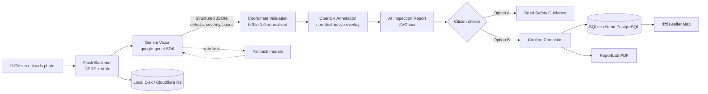

<div align="center">

<!-- [ADD: assets/banner.png, 1280x640] -->


# 🛡️ VisionGuard AI 2.0

### Gemini-Powered Multimodal Infrastructure Defect Detection Platform

*Snap a photo. Spot the defect. File the complaint. All in minutes.*


[🚀 Live Demo]([ADD: LIVE DEMO URL]) • [🎥 Demo Video]([ADD: VIDEO URL]) • [📊 PPT]([ADD: PPT URL]) • [🐞 Report Issues](https://github.com/szeeshanZ123/visionGuard/issues)

</div>

---

## 📑 Table of Contents

- [The Problem](#-the-problem)
- [Our Solution](#-our-solution)
- [Key Features](#-key-features)
- [Why We Stand Out](#-why-we-stand-out)
- [Screenshots & Demo](#-screenshots--demo)
- [System Architecture](#-system-architecture)
- [Tech Stack](#-tech-stack)
- [Project Structure](#-project-structure)
- [Getting Started](#-getting-started)
- [Usage Walkthrough](#-usage-walkthrough)
- [Testing](#-testing)
- [Results & Impact](#-results--impact)
- [Limitations](#-limitations)
- [Roadmap](#-roadmap)
- [Team](#-team)
- [Acknowledgements](#-acknowledgements)
- [License & Disclaimer](#-license--disclaimer)

---

## 🚨 The Problem

Potholes, wall cracks, damp patches and spalling concrete are safety hazards for drivers, pedestrians and building occupants.

- Manual civil inspections are **slow, subjective and hard to audit**.
- Citizens who spot hazards have **no easy way to document evidence** or write a formal municipal complaint.
- The result: defects stay unreported and keep getting worse.

> [ADD: one real statistic about road or building damage in your region, with source]

---

## 💡 Our Solution

**VisionGuard AI** analyses a road or building photo with **Google Gemini Multimodal Vision**, finds every visible defect, draws bounding boxes, rates preliminary severity, and lets the citizen file a **formal complaint with a PDF**, pinned on a live map.

> **Elevator pitch:** Upload a photo, get an AI inspection report, and file a civic complaint in one flow.

---

## ✨ Key Features

| | Feature | Benefit |
|---|---|---|
| 🔍 | **Multi-defect detection** | Finds several defects in one photo, each with an ID (`[D001]`, `[D002]`) |
| 🛣️ | **Road inspection** | Potholes, longitudinal, transverse and alligator cracks, raveling |
| 🏢 | **Building inspection** | Wall cracks, dampness, peeling paint, plaster damage, spalling |
| 🎯 | **OpenCV overlays** | Color-coded bounding boxes and severity pills; the original photo stays untouched |
| 🚦 | **Severity triage** | Critical, High, Moderate, Low or Uncertain, with safety disclaimers |
| 📝 | **AI inspection report** | Reference ID (e.g. `#VG-104`), itemized defects, remediation and urgency |
| 🧭 | **Dual citizen pathways** | Read safety guidance only, or submit a verified complaint |
| 📄 | **PDF export** | Formal municipal complaint generated with ReportLab |
| 🗺️ | **Interactive map** | Every verified complaint plotted on Leaflet.js |
| 🔐 | **Security built in** | CSRF validation, role-based auth, API key never exposed to the frontend |
| 🔁 | **Model fallback** | Auto-rotates across Gemini models on rate limits or version changes |

### Severity Color Code

| Severity | Color |
|---|---|
| Critical | 🔴 Crimson `#EF4444` |
| High | 🟠 Orange `#F97316` |
| Moderate | 🟡 Amber `#F59E0B` |
| Low | 🔵 Blue `#3B82F6` |
| Uncertain | ⚪ Slate `#64748B` |

---

## 🏆 Why We Stand Out

| Criteria | Traditional Inspection | Typical Photo-Upload Apps | **VisionGuard AI 2.0** |
|---|---|---|---|
| Speed | Days to weeks | Minutes | **Minutes** |
| Multiple defects per image | Manual notes | Often one label | **Itemized with IDs and boxes** |
| Visual evidence | Paper notes | Plain photo | **Annotated, non-destructive overlay** |
| Formal complaint | Manual writing | Rarely included | **Auto-drafted PDF** |
| Location tracking | Manual | Limited | **Live Leaflet map** |
| Responsible AI | N/A | Often overclaims | **Preliminary-assessment disclaimers throughout** |
| Cost to run | High labor cost | Varies | **Free-tier-friendly Gemini model** |

> [ADD or EDIT: adjust the "Typical Photo-Upload Apps" column to the real competitors you studied]

---

## 📸 Screenshots & Demo

<div align="center">

<!-- [ADD: assets/demo.gif] -->


| Landing Page | Inspection Studio |
|:---:|:---:|
|  |  |
| **Annotated Overlay** | **AI Inspection Report** |
|  |  |
| **Complaint Confirmation** | **Defect Map** |
|  |  |

</div>

---

## 🏗️ System Architecture



**How it works**
1. The citizen uploads a road or building photo.
2. Gemini returns structured JSON with defects, severity and normalized coordinates.
3. OpenCV converts coordinates to pixels and draws overlays on a copy of the photo.
4. The report is generated, and the citizen reads guidance or files a complaint.
5. The complaint is saved, exported as a PDF and plotted on the map.

**Model management:** primary model `gemini-3.1-flash-lite`, configurable via `GEMINI_MODEL`, with automatic fallback to `gemini-flash-latest`, `gemini-3.8-flash` and `gemini-2.5-flash`.

---

## 🧰 Tech Stack

| Layer | Technology |
|---|---|
| **AI Vision** | Google Gemini Multimodal Vision · `google-genai` SDK |
| **Annotation** | OpenCV (`opencv-python`) |
| **Backend** | Python 3.10+ · Flask 3.1 |
| **Server** | Waitress (Windows) · Gunicorn (Linux) |
| **Database** | SQLite · Neon PostgreSQL |
| **Storage** | Local Disk · Cloudflare R2 |
| **PDF** | ReportLab 4.x |
| **Frontend** | HTML5 · Tailwind CSS · Vanilla JS · Leaflet.js |
| **Testing** | pytest |

<div align="center">


</div>

---

## 📁 Project Structure

```text
visionGuard/
├── ai/
│   ├── gemini_service.py      # Gemini vision, defect analysis, model fallback
│   └── models/                # Legacy YOLO weights (research only, not used in production)
├── database/
│   └── db.py                  # SQLite / PostgreSQL persistence
├── data/
│   ├── visionguard.db         # Default local database
│   └── evaluation_benchmark/  # Benchmark images
├── tests/                     # 81 automated tests
├── wsgi.py                    # App entry point
├── requirements.txt
├── .env.example
└── assets/                    # README images
```

> [ADD: correct any folders that differ from your real repo]

---

## 🚀 Getting Started

**Prerequisites:** Python 3.10 to 3.14, `venv`, internet access, and a free [Gemini API key](https://aistudio.google.com/).

```bash
# 1. Clone
git clone https://github.com/szeeshanZ123/visionGuard.git
cd visionGuard

# 2. Virtual environment
python -m venv venv
source venv/bin/activate        # Linux/macOS
.\venv\Scripts\activate         # Windows

# 3. Install dependencies
pip install -r requirements.txt

# 4. Configure environment
cp .env.example .env            # Windows: copy .env.example .env

# 5. Run
python wsgi.py
```

Open **http://127.0.0.1:5000**

### 🔑 Environment Variables

```env
AI_PROVIDER=gemini
GEMINI_API_KEY=your_actual_gemini_api_key_here
GEMINI_MODEL=gemini-3.1-flash-lite
VISIONGUARD_SECRET_KEY=your_random_64_character_secret_key_here
VISIONGUARD_DB_PATH=data/visionguard.db
STORAGE_BACKEND=local
```

Generate a secret key:

```bash
python -c "import secrets; print(secrets.token_hex(32))"
```

> 🔒 The API key is loaded only from environment variables. It is never exposed to frontend JavaScript, logs or API responses.

---

## 🎬 Usage Walkthrough

1. **Sign in** as a citizen (session security and CSRF protection are active).
2. **Open Inspection Studio** (`/create_home`) and pick *Road Surface Distress* or *Home & Building Defect*.
3. **Upload a photo**, for example `data/evaluation_benchmark/images/benchmark_08_d20_alligator_urban.jpg`.
4. **Click Detect Defect.** Progress runs through five steps: Upload → Gemini analysis → Defect & severity identification → OpenCV overlay → Report compilation.
5. **Toggle** between the annotated overlay and the original photo.
6. **Review the report:** severity badge, summary, itemized defects and repair recommendations.
7. **Choose a pathway:**
   - **Option A:** read full guidance and safety steps.
   - **Option B:** review pre-filled GPS, address and notes, then confirm the complaint.
8. **Download the PDF** and see the new pin on the **Interactive Map**.

---

## ✅ Testing

```bash
python -m pytest tests/ -v
```

**81 automated tests, all passing.**

| Suite | Tests | Covers |
|---|---|---|
| `test_gemini_multimodal_platform.py` | 17 | Road and building detection, multi-defect boxes, clean surfaces (zero false positives), blurry images, invalid uploads, coordinate clamping, API timeout and quota (HTTP 429), missing key, non-destructive annotation, persistence, duplicate-complaint prevention |
| Regression & security suites | 64 | RBAC (`test_auth_and_roles.py`), CSRF (`test_citizen_csrf_security_routing.py`), complaint drafts and PDFs (`test_complaint_assistance.py`), map queries (`test_defect_map.py`) |

---

## 📈 Results & Impact

| Metric | Value |
|---|---|
| Automated tests passing | **81 / 81** |
| Defect categories supported | **10** (5 road, 5 building) |
| Detection accuracy | [ADD: value + how measured] |
| Avg. analysis time per image | [ADD: seconds] |
| Images evaluated in benchmark | [ADD: count] |
| Users who tested it | [ADD: count] |

---

## ⚠️ Limitations

- **Visual line-of-sight only.** Subsurface voids, internal rebar corrosion and underground leaks need specialized NDT equipment.
- **Image quality matters.** Dark or blurred photos may give uncertain localization.
- **Preliminary screening only.** Results do not replace a certified engineering survey.

---

## 🗺️ Roadmap

- [x] Gemini multimodal defect detection
- [x] Multi-defect itemization with OpenCV overlays
- [x] Complaint workflow with PDF export
- [x] Interactive defect map
- [x] RBAC, CSRF protection and automated test suite
- [ ] Fine-tuned edge models (YOLOv8 Nano) for offline dashcam inference
- [ ] Drone survey ingestion (orthomosaic batches for roads and roofs)
- [ ] Municipal grievance integration via Open311 webhooks

---

## 👥 Team

**Team [ADD: TEAM NAME]**, NEURA X 2026 — Global Hackathon 2K26 · Track: [ADD: TRACK]

| Avatar | Name | Role | Links |
|:---:|---|---|---|
|  | [ADD: NAME] | [ADD: ROLE] | [GitHub](https://github.com/[ADD-USERNAME]) · [LinkedIn]([ADD: URL]) |
|  | [ADD: NAME] | [ADD: ROLE] | [GitHub](https://github.com/[ADD-USERNAME]) · [LinkedIn]([ADD: URL]) |
|  | [ADD: NAME] | [ADD: ROLE] | [GitHub](https://github.com/[ADD-USERNAME]) · [LinkedIn]([ADD: URL]) |

---

## 🙏 Acknowledgements

- **NEURA X 2026** organizers and mentors
- [Google Gemini](https://ai.google.dev/) and Google AI Studio
- OpenCV, Flask, ReportLab, Leaflet.js, Tailwind CSS, Neon, Cloudflare R2

---

## 📜 License & Disclaimer

Licensed under **[ADD: LICENSE]**. See `LICENSE`.

> Preliminary visual defect assessments from VisionGuard AI 2.0 are for informational and civic assistance purposes only. They are not a certified structural engineering survey, legal warranty or municipal repair guarantee.

**Contact:** [ADD: email] · [Repository](https://github.com/szeeshanZ123/visionGuard)

---

<div align="center">

**Built with ❤️ for NEURA X 2026 — Global Hackathon 2K26**

[⬆ Back to top](#-visionguard-ai-20)

</div>
