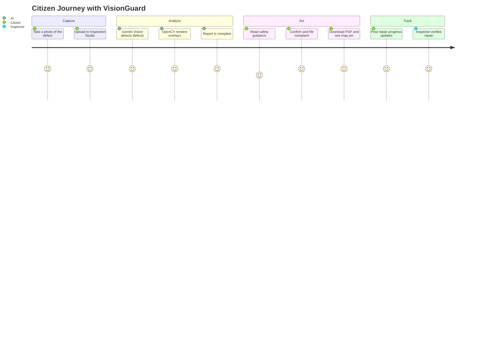
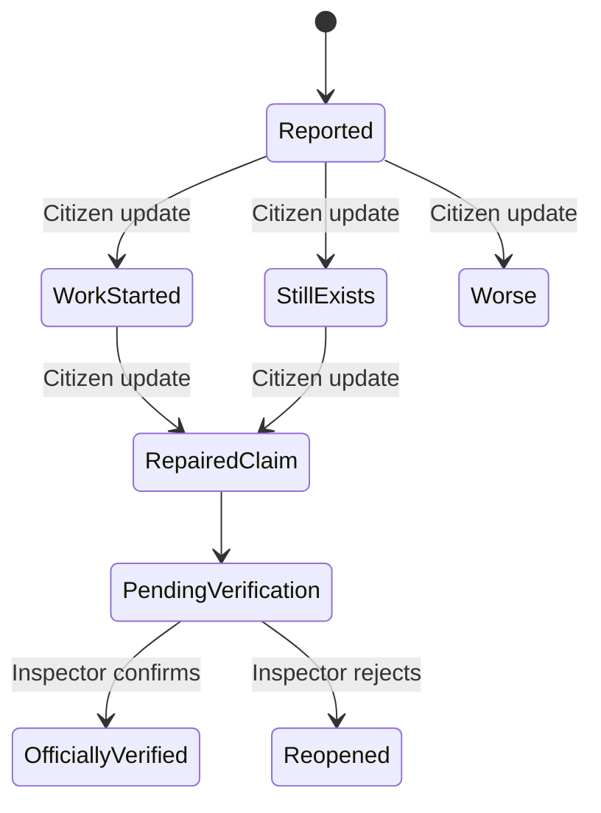
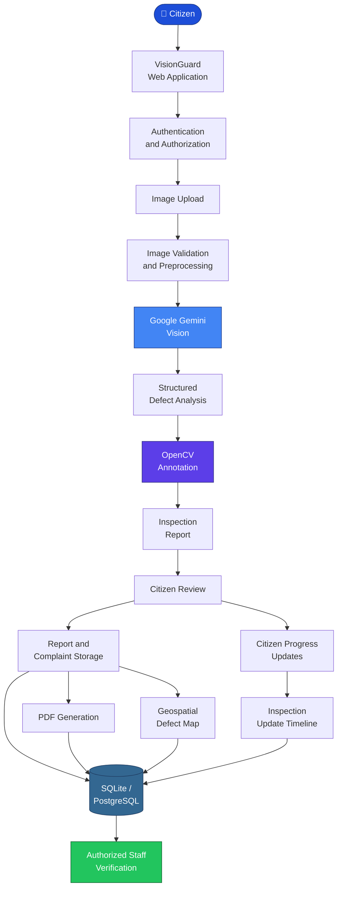
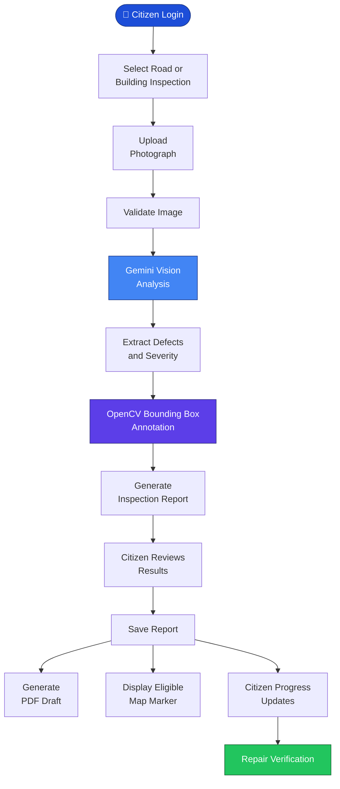
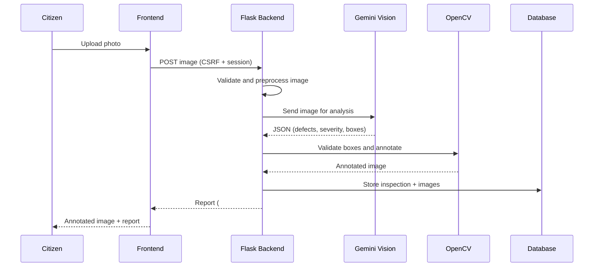
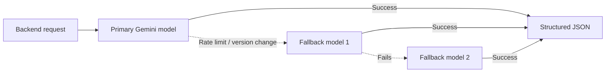

<a id="top"></a>

<div align="center">


<br/>

# 🛡️ VisionGuard AI 2.0

### AI-Powered Multimodal Infrastructure Defect Detection, Inspection & Citizen Reporting Platform

*See the defect. File the complaint. Track the repair. Fix the city.*

<a href="https://github.com/szeeshanZ123/visionGuard">
  
</a>

<br/>


<br/>

[🚀 **Live Application**](https://visionguard-ttyp.onrender.com/) &nbsp;•&nbsp; [🎥 **Demo Video**]([ADD: VIDEO URL]) &nbsp;•&nbsp; [📊 **Presentation**]([ADD: PPT URL]) &nbsp;•&nbsp; [🐞 **Report Issue**](https://github.com/szeeshanZ123/visionGuard/issues)

</div>

---

## 🎯 Hackathon Problem Statement

> **Vision AI**
> *Build an AI system that analyses images and identifies meaningful real-world problems, defects, or abnormalities.*

**How VisionGuard answers it:** VisionGuard analyses photographs of roads and buildings, identifies multiple real-world defects (potholes, cracks, dampness, spalling and more), classifies them, estimates preliminary severity, marks them visually on the image, and turns the result into an actionable civic report that can be tracked until the issue is repaired.

---

## ⏱️ The 60-Second Summary

| | |
|---|---|
| **🎯 Problem** | Road and building defects go unreported because inspection is slow, manual and citizens have no easy way to file evidence-backed complaints or follow up on repairs. |
| **💡 Solution** | Upload one photo. Gemini Multimodal Vision finds every visible defect, OpenCV marks it, and the citizen files a formal complaint PDF pinned on a live map, then tracks repair progress over time. |
| **🧠 Core Tech** | Google Gemini Vision · OpenCV · Flask · ReportLab · Leaflet.js · Tailwind CSS |
| **✅ Proof** | 81 automated tests covering AI inference, security, complaints, maps and citizen updates. |
| **🔒 Responsible AI** | Every result is labelled a *preliminary visual assessment*, never a certified engineering survey. |
| **🌐 Live** | [visionguard-ttyp.onrender.com](https://visionguard-ttyp.onrender.com/) |

---

## 📑 Table of Contents

<details>
<summary><b>Click to expand</b></summary>

1. [Project Description](#-project-description)
2. [The Problem](#-the-problem)
3. [Our Solution](#-our-solution)
4. [Project Objectives](#-project-objectives)
5. [How It Works](#-how-it-works)
6. [Key Features](#-key-features)
7. [Citizen Report Update System](#-citizen-report-update-system)
8. [Why VisionGuard Stands Out](#-why-visionguard-stands-out)
9. [Screenshots & Demo](#-screenshots--demo)
10. [System Architecture](#-system-architecture)
11. [AI Detection & Image Processing](#-ai-detection--image-processing)
12. [Tech Stack](#-tech-stack)
13. [Database & Data Management](#-database--data-management)
14. [Security & Privacy](#-security--privacy)
15. [Project Structure](#-project-structure)
16. [Getting Started](#-getting-started)
17. [Environment Configuration](#-environment-configuration)
18. [Usage Walkthrough](#-usage-walkthrough)
19. [Testing & Quality](#-testing--quality)
20. [Deployment](#-deployment)
21. [Results & Impact](#-results--impact)
22. [Limitations](#-limitations)
23. [Roadmap & Future Scope](#-roadmap--future-scope)
24. [Contributors](#-contributors)
25. [Acknowledgements](#-acknowledgements)
26. [Project Links](#-project-links)
27. [License & Disclaimer](#-license--disclaimer)

</details>

---

## 📖 Project Description

**VisionGuard AI 2.0** is an AI-powered multimodal infrastructure inspection and citizen reporting platform designed to **identify, document, visualize and track** visible infrastructure defects in roads, highways and buildings.

The platform uses Google's **Gemini Multimodal Vision** model to analyse uploaded photographs, identify multiple visible defects, classify their categories, estimate preliminary severity and generate structured inspection reports.

VisionGuard combines **Artificial Intelligence, image processing, geospatial visualization and citizen participation** in one integrated platform.

Citizens can:

- Upload photographs of damaged roads or buildings
- Receive AI-generated inspection results
- View annotated defect images
- Generate PDF reports
- Submit civic complaint drafts
- Track the progress of previously reported issues

A key feature is the **Citizen Report Update System**, which lets users update an existing report when repair work begins, when an issue remains unresolved, when conditions worsen, or when a road appears to have been repaired. This creates a **continuous reporting and monitoring cycle** rather than treating each inspection as an isolated event.

---

## 🚨 The Problem

Urban infrastructure is continuously exposed to environmental conditions, heavy traffic, water infiltration, material deterioration and structural stress. This leads to common problems such as:

- 🕳️ Potholes and damaged road surfaces
- ↔️ Longitudinal and transverse road cracks
- 🕸️ Alligator cracking and pavement deterioration
- 🧱 Wall cracks and surface fractures
- 💧 Dampness and water infiltration
- 🎨 Peeling paint and plaster damage
- 🏗️ Concrete spalling and surface deterioration

Traditional inspection depends on manual observation and reporting, which creates several challenges:

| Challenge | Description |
|---|---|
| ⏳ **Time-consuming inspections** | Identifying and documenting defects manually requires significant time and human effort. |
| 📭 **Delayed reporting** | Citizens notice damage but lack a simple, accessible reporting mechanism. |
| 🖼️ **Limited visual documentation** | Reports often lack standardized photographs, defect classification or supporting evidence. |
| 📊 **No centralized tracking** | Citizens cannot easily know whether a reported issue is being addressed. |
| 👁️ **Poor progress visibility** | A reported pothole may be repaired, but the original report never reflects real-world progress. |
| 🗺️ **Limited geospatial awareness** | Defects must be tied to locations to support monitoring and prioritization. |

> 📌 [ADD: one real statistic about road or building damage in your region, with source]

There is a clear need for an **accessible, intelligent and transparent system** that connects defect detection with citizen reporting, location-based visualization and progress tracking.

---

## 💡 Our Solution

**VisionGuard AI** turns any smartphone photo into an **inspection report and an actionable civic complaint**, then keeps the report alive through progress tracking.

> **Elevator pitch:** *Upload a photo, get an AI inspection report, file a civic complaint, and track the repair, all in one flow.*

| Step | What happens |
|:---:|---|
| 1️⃣ | Citizen uploads a road or building photo |
| 2️⃣ | Gemini Vision identifies and itemizes defects (`D001`, `D002`, ...) |
| 3️⃣ | OpenCV draws severity-coded bounding boxes on a copy of the photo |
| 4️⃣ | A structured inspection report is generated (`#VG-xxx`) |
| 5️⃣ | Citizen reads safety guidance **or** files a complaint with PDF and map pin |
| 6️⃣ | Citizen later posts progress updates (work started, repaired, still exists, worse) |

### Solution Components

**3.1 AI-Powered Defect Detection:** Gemini Multimodal Vision analyses road and building photographs, identifies visible defects, categorizes them and generates preliminary severity assessments.

**3.2 Automated Image Annotation:** OpenCV draws bounding boxes around detected defects. Each defect gets an ID label (such as `D001`, `D002`) and a visual severity indicator.

**3.3 Structured Inspection Reports:** Each report contains the inspection reference ID, defect category, number of detected defects, preliminary severity, visual evidence, AI observations, suggested maintenance actions and safety recommendations.

**3.4 Citizen Reporting & Complaint Assistance:** Citizens review AI findings and prepare civic complaint reports. The platform supports report storage and PDF draft generation for further submission through appropriate channels.

**3.5 Geospatial Defect Visualization:** An interactive map visualizes eligible defect reports using geographic coordinates.

**3.6 Citizen Report Progress Tracking:** Citizens revisit previous reports and communicate real-world changes with comments and updated photos. Repair claims stay *pending verification* until an authorized inspector confirms them.

---

## 🎯 Project Objectives

- ✅ Automate the preliminary identification of visible infrastructure defects
- ✅ Reduce the effort required to document infrastructure problems
- ✅ Generate structured, visually supported inspection reports
- ✅ Improve accessibility of civic infrastructure reporting
- ✅ Provide geographical visualization of eligible reported defects
- ✅ Allow citizens to track the progress of their submitted reports
- ✅ Support transparent communication about repair progress
- ✅ Maintain historical inspection records and supporting evidence
- ✅ Provide a foundation for future smart-city infrastructure monitoring systems

---

## 🔄 How It Works



---

## ✨ Key Features

### 🛣️ A. Road Infrastructure Inspection

| Defect | Description |
|---|---|
| **Potholes** | Cavities and damaged road surfaces |
| **Longitudinal Cracks** | Cracks running parallel to the road |
| **Transverse Cracks** | Cracks running across the road |
| **Alligator Cracking** | Interconnected fatigue cracks |
| **Surface Deterioration** | Visible pavement wear and material loss |
| **Raveling** | Loss of asphalt aggregate from the road surface |

### 🏢 B. Building Infrastructure Inspection

| Defect | Description |
|---|---|
| **Wall Cracks** | Visible fractures in walls and plaster |
| **Dampness** | Moisture-related surface damage |
| **Water Infiltration** | Visible signs of water seepage |
| **Peeling Paint** | Deterioration of painted surfaces |
| **Plaster Damage** | Cracking and deterioration of plaster |
| **Surface Spalling** | Visible loss or detachment of concrete or plaster |

### 🤖 C. AI-Based Image Analysis

- Google Gemini Multimodal Vision integration
- Multiple visible defect identification
- Structured JSON output
- Defect categorization
- Preliminary severity classification
- Image validation and preprocessing
- Handling of unclear or inconclusive images
- Automatic model fallback on rate limits

### 🎯 D. OpenCV Image Annotation

- Bounding box visualization
- Individual defect identification labels
- Color-coded severity indicators
- Normalized coordinate validation (`0.0 ≤ x1 < x2 ≤ 1.0`)
- **Original image preservation** (non-destructive overlay)
- Annotated image generation
- Toggle between annotated and original view

### 📝 E. Inspection Report Generation

Each inspection can include:

- Unique inspection reference (e.g. `#VG-104`)
- Original photograph
- Annotated photograph
- Defect identification and count
- Preliminary severity assessment
- AI-generated description
- Recommended maintenance actions and urgency priority
- Safety recommendations
- Geographical information when available

### 📄 F. PDF Report Generation

VisionGuard uses **ReportLab** to generate downloadable PDF documentation containing inspection and complaint information. These documents support record keeping and preparation of civic complaints.

### 🗺️ G. Interactive Geospatial Defect Map

- Interactive **Leaflet.js** map
- Location-based defect markers
- Defect category filters
- Inspection location information
- Marker details
- Map synchronization and data refresh
- Only **public-safe records** are exposed on the public map

### 🔁 H. Citizen Report Update System

See the [dedicated section](#-citizen-report-update-system) below.

### 🔐 I. Authentication & Access Control

- Citizen registration and login
- Password-based authentication
- Google OAuth integration
- Session-based authentication
- Role-based access control (RBAC)
- CSRF protection
- Report ownership validation
- Protected inspection and update endpoints
- Duplicate complaint prevention

### 🗂️ J. Historical Inspection Records

Users can revisit previously submitted inspection reports, view inspection details and review all associated progress updates.

### 🚦 Severity Color Code

| Severity | Color | Hex |
|---|---|---|
| Critical | 🔴 Crimson | `#EF4444` |
| High | 🟠 Orange | `#F97316` |
| Moderate | 🟡 Amber | `#F59E0B` |
| Low | 🔵 Blue | `#3B82F6` |
| Uncertain / Inconclusive | ⚪ Slate | `#64748B` |

---

## 🔁 Citizen Report Update System

A major feature of VisionGuard AI 2.0 is the ability to **update previously submitted reports** instead of treating every inspection as a one-time event.

**A citizen can:**

1. Open an existing inspection report
2. Select the current condition
3. Add an optional comment
4. Upload updated photographic evidence
5. Submit the progress update
6. View the chronological report timeline

**Supported update types:**

| Update | Meaning |
|---|---|
| 🛠️ **Work Started** | Citizen reports that repair activity has begun |
| ✅ **Road Repaired** | Citizen reports that the defect appears repaired |
| ⚠️ **Issue Still Exists** | Citizen reports that the problem remains |
| 📈 **Issue Has Become Worse** | Citizen reports further deterioration |

> ⚖️ **Important:** Citizen-reported updates are **separate from official inspection verification**. Selecting *Road Repaired* does **not** automatically mark an inspection as officially resolved. An authorized inspector must verify the repair.



---

## 🏆 Why VisionGuard Stands Out

| Criteria | Manual Inspection | Typical Photo-Upload Apps | **VisionGuard AI 2.0** |
|---|:---:|:---:|:---:|
| Turnaround | Days to weeks | Minutes | ✅ **Minutes** |
| Multiple defects in one image | ❌ Manual notes | ⚠️ Often one label | ✅ **Itemized with IDs and boxes** |
| Annotated visual evidence | ❌ | ⚠️ Plain photo | ✅ **Non-destructive overlay** |
| Formal complaint document | ❌ Written by hand | ❌ Rare | ✅ **Auto-generated PDF** |
| Location tracking | ❌ | ⚠️ Limited | ✅ **Live Leaflet map** |
| Repair progress tracking | ❌ | ❌ Rare | ✅ **Citizen update timeline** |
| Honest AI disclaimers | N/A | ⚠️ Often overclaims | ✅ **Built into every result** |
| Failure handling | N/A | ⚠️ Varies | ✅ **Model fallback, quota and timeout tests** |
| Running cost | High labor | Varies | ✅ **Free-tier-friendly model** |

> ✏️ [EDIT: replace the middle column with the real competitors you researched]

---

## 📸 Screenshots & Demo

<div align="center">


<br/><br/>

| 🏠 Landing Page | 🧪 Inspection Studio |
|:---:|:---:|
|  |  |
| **🎯 Annotated Overlay** | **📋 AI Inspection Report** |
|  |  |
| **✅ Complaint Confirmation** | **🗺️ Defect Map** |
|  |  |

</div>

---

## 🏗️ System Architecture

VisionGuard follows a **modular architecture** connecting the frontend, Flask backend, AI analysis engine, image processing layer, database and storage system.

### High-Level Architecture



**Layer-by-layer explanation:**

| Stage | Component | Responsibility |
|---|---|---|
| 1 | **Citizen** | Starts the inspection from the web app |
| 2 | **VisionGuard Web Application** | Flask backend and Tailwind frontend |
| 3 | **Authentication and Authorization** | Login, Google OAuth, sessions, RBAC and CSRF checks |
| 4 | **Image Upload** | Secure upload with safe filename handling |
| 5 | **Image Validation and Preprocessing** | Format, size and quality checks before AI analysis |
| 6 | **Google Gemini Vision** | Multimodal analysis of the photograph |
| 7 | **Structured Defect Analysis** | JSON of defects, categories, severity and bounding boxes |
| 8 | **OpenCV Annotation** | Draws severity-coded boxes and IDs on a copy of the image |
| 9 | **Inspection Report** | Structured report with reference ID `#VG-xxx` |
| 10 | **Citizen Review** | Citizen checks the results and chooses the next action |
| 11 | **Report and Complaint Storage** | Persists the report, complaint data and images |
| 12 | **PDF Generation** | ReportLab complaint and inspection PDF |
| 13 | **Geospatial Defect Map** | Leaflet map of eligible public-safe records |
| 14 | **Citizen Progress Updates** | Work started, repaired, still exists, worse |
| 15 | **Inspection Update Timeline** | Chronological history of every update |
| 16 | **SQLite / PostgreSQL** | Persistent storage of users, inspections and updates |
| 17 | **Authorized Staff Verification** | Inspector confirms or rejects repair claims |

### Inspection Workflow



**Workflow steps:**

1. **Citizen Login** with username and password or Google OAuth
2. **Select Road or Building Inspection** to pick the defect domain
3. **Upload Photograph** from a phone or computer
4. **Validate Image** (format, size, readability)
5. **Gemini Vision Analysis** of the validated photo
6. **Extract Defects and Severity** into structured JSON
7. **OpenCV Bounding Box Annotation** on a copy of the original
8. **Generate Inspection Report** with ID `#VG-xxx`
9. **Citizen Reviews Results** and decides what to do
10. **Save Report** to the database and image storage
11. **Three outputs:** generate a **PDF draft**, display an **eligible map marker**, or post **citizen progress updates**
12. **Repair Verification** by an authorized inspector once a citizen reports progress

### Request Sequence



### Resilience: Model Fallback



---

## 🧠 AI Detection & Image Processing

### Google Gemini Vision

VisionGuard uses Google's **Gemini multimodal model** as its primary active image-analysis engine. The AI analyses uploaded photographs and returns **structured defect information**. The backend uses the official **Google Gen AI Python SDK**.

```env
AI_PROVIDER=gemini
GEMINI_MODEL=gemini-3.1-flash-lite
```

### OpenCV Annotation

After receiving structured defect information, the image-processing layer converts **normalized bounding box coordinates** into pixel coordinates. The annotation engine validates coordinate boundaries before drawing overlays.

```python
x1 = int(normalized_x1 * image_width)
y1 = int(normalized_y1 * image_height)

x2 = int(normalized_x2 * image_width)
y2 = int(normalized_y2 * image_height)
```

The resulting image shows defect bounding boxes and ID labels. **The original photograph remains unchanged.**

### Severity Classification

| Level | Meaning |
|---|---|
| **Critical** | Immediate attention recommended |
| **High** | Serious defect, prompt action advised |
| **Moderate** | Noticeable deterioration |
| **Low** | Minor defect |
| **Uncertain / Inconclusive** | Image quality or content insufficient |

> These are **AI-generated screening assessments** and not certified engineering conclusions.

### Model Management

- **Automatic fallback rotation:** if the primary model hits rate limits or a version change, the engine rotates across backup vision models.
- **Research artifacts:** historical **YOLOv8** checkpoints (`ai/models/best.pt`, `home_best.pt`) are preserved only for offline comparative research and future edge-model development. They are **not** the active production inference engine.

---

## 🧰 Tech Stack

| Component | Technology | Purpose |
|---|---|---|
| 🐍 Language | Python 3.10+ | Backend and AI integration |
| ⚙️ Web Framework | Flask 3.1 | Application backend and REST APIs |
| 🧠 AI Engine | Google Gemini Vision | Multimodal defect analysis |
| 🔌 AI SDK | Google Gen AI SDK (`google-genai`) | Gemini API integration |
| 🤖 Active Model | `gemini-3.1-flash-lite` | Image understanding and analysis |
| 🎨 Image Processing | OpenCV (`opencv-python`) | Bounding boxes and annotations |
| 🔢 Data Processing | NumPy | Numerical and image operations |
| 🌐 Frontend | HTML5 · Vanilla JavaScript | Page structure and interactions |
| 💅 Styling | Tailwind CSS | Responsive user interface |
| 🗺️ Maps | Leaflet.js | Geospatial visualization |
| 🗄️ Database | SQLite / PostgreSQL | Users and inspection records |
| ☁️ Cloud Database | Neon PostgreSQL | Hosted relational persistence |
| 📦 Object Storage | Local Disk / Cloudflare R2 | Inspection image storage |
| 📄 PDF | ReportLab 4.x | PDF documentation |
| 🔐 Authentication | Flask Sessions / Google OAuth | User authentication |
| 🖥️ Server | Waitress (Windows) · Gunicorn (Linux) | Production serving |
| 🧪 Testing | Pytest | Automated testing |
| 🚀 Deployment | Render | Web application hosting |

<div align="center">


</div>

---

## 🗄️ Database & Data Management

VisionGuard supports **SQLite** for local development and **PostgreSQL (Neon)** for hosted deployment.

**Major data entities:**

- Users
- Inspection records
- Defect information
- Complaint information
- Citizen inspection updates
- Maintenance activity records

### Citizen Inspection Updates (`inspection_updates`)

| Field | Purpose |
|---|---|
| `id` | Unique update identifier |
| `inspection_id` | Associated inspection |
| `user_id` | User submitting the update |
| `username` | Associated username, where stored |
| `update_type` | Reported progress condition |
| `comment` | Optional citizen description |
| `image_path` | Optional supporting photograph |
| `verification_status` | Verification state |
| `created_at` | Update timestamp |

The update history is linked to the **original inspection** rather than creating a new inspection for every progress update.

---

## 🔒 Security & Privacy

VisionGuard implements application-level protections to safeguard user information and inspection records.

- 🔑 Password-based authentication
- 🌐 Google OAuth authentication
- 🍪 Session management
- 🛡️ Role-based route protection
- 🧾 CSRF validation
- 👤 Inspection ownership verification
- 📤 Secure image upload validation
- 📁 Safe filename handling
- 🖼️ Protected image retrieval
- 🚫 Restricted access to private inspection records
- 🧼 Public-map data sanitization
- 🔏 API key never exposed to frontend, logs or responses

**Integrity and privacy rules:**

- Citizen repair claims **do not** directly overwrite official inspection statuses.
- Private comments, user identities and private inspection photographs **must not** be exposed through public map endpoints.
- API keys and secrets must be stored in **environment variables**, never in frontend code or source control.

---

## 📁 Project Structure

```text
visionGuard/
├── ai/
│   ├── vision_service.py      # Gemini Vision calls, defect analysis, model fallback
│   └── models/                # Legacy YOLO weights (research only)
├── database/
│   └── db.py                  # SQLite / PostgreSQL persistence
├── data/
│   ├── visionguard.db         # Default local database
│   └── evaluation_benchmark/  # Benchmark images
├── tests/                     # Automated test suite
├── assets/                    # README images, screenshots and GIFs
├── wsgi.py                    # App entry point
├── requirements.txt
└── .env.example
```

> ✏️ [ADD: adjust any folder or file name that differs from your real repo]

---

## 🚀 Getting Started

### Prerequisites

- Python **3.10 or later** (3.10 to 3.14 supported)
- Git
- Internet connection
- A free **Google Gemini API key** from [Google AI Studio](https://aistudio.google.com/)
- A code editor such as VS Code

### Installation

```bash
# 1. Clone the repository
git clone https://github.com/szeeshanZ123/visionGuard.git
cd visionGuard

# 2. Create a virtual environment
python -m venv venv

# Windows
.\venv\Scripts\activate

# Linux / macOS
source venv/bin/activate

# 3. Install dependencies
pip install -r requirements.txt

# 4. Configure environment
cp .env.example .env            # Windows: copy .env.example .env

# 5. Run the application
python wsgi.py
```

Open **http://127.0.0.1:5000** 🎉

> 🔒 Never commit `.env` or expose API keys in public repositories.

---

## ⚙️ Environment Configuration

Create a `.env` file in the project root:

```env
AI_PROVIDER=gemini
GEMINI_API_KEY=your_gemini_api_key
GEMINI_MODEL=gemini-3.1-flash-lite

VISIONGUARD_SECRET_KEY=your_secure_random_secret
VISIONGUARD_DB_PATH=data/visionguard.db

STORAGE_BACKEND=local
```

Generate a secure secret key:

```bash
python -c "import secrets; print(secrets.token_hex(32))"
```

| Variable | Description |
|---|---|
| `AI_PROVIDER` | Selects the AI provider |
| `GEMINI_API_KEY` | Google Gemini API key |
| `GEMINI_MODEL` | Configured Gemini model |
| `VISIONGUARD_SECRET_KEY` | Flask session security key |
| `VISIONGUARD_DB_PATH` | Local SQLite database path |
| `DATABASE_URL` | PostgreSQL connection string (when configured) |
| `STORAGE_BACKEND` | Storage provider selection (`local` or Cloudflare R2) |
| `GOOGLE_CLIENT_ID` | Google OAuth client identifier |
| `GOOGLE_CLIENT_SECRET` | Google OAuth client secret |
| `GOOGLE_REDIRECT_URI` | OAuth callback URL |

Configure additional database, OAuth and object-storage variables according to `.env.example` and your deployment environment. In production, manage them through the hosting provider's environment settings.

**Get an API key:** open [Google AI Studio](https://aistudio.google.com/), sign in, click **Get API key**, and paste it into `.env`.

---

## 🎬 Usage Walkthrough

1. **Sign in** as a citizen (session security and CSRF protection are active).
2. **Open Inspection Studio** (`/create_home`) and choose *Road Surface Distress* or *Home & Building Defect*.
3. **Upload a photo**, for example `data/evaluation_benchmark/images/benchmark_08_d20_alligator_urban.jpg`.
4. **Click Detect Defect.** Watch five steps: Upload → AI analysis → Defect and severity identification → OpenCV overlay → Report compilation.
5. **Toggle** between the annotated overlay and the original photo.
6. **Review the report:** severity badge, summary, itemized defects, repair recommendations.
7. **Choose a pathway:**
   - **Option A:** read full guidance and safety steps.
   - **Option B:** check pre-filled GPS, address and notes, then confirm the complaint.
8. **Download the PDF** and find the new pin on the **Interactive Map**.
9. **Come back later** to open the report, post a progress update (Work Started, Road Repaired, Issue Still Exists, Issue Has Become Worse) with an optional comment and photo, and view the timeline.

---

## ✅ Testing & Quality

```bash
python -m pytest tests/ -v
```

<div align="center">

**81 automated tests · 100% passing**

</div>

| Suite | What it proves |
|---|---|
| `test_gemini_multimodal_platform.py` | Road and building detection, multi-defect boxes, zero false positives on clean roads, blurry and invalid uploads, coordinate clamping, quota (HTTP 429) and timeout handling, missing-key diagnostics, non-destructive annotation, SQLite and PostgreSQL persistence, duplicate complaint prevention |
| `test_auth_and_roles.py` | Role-based access enforcement |
| `test_citizen_csrf_security_routing.py` | CSRF token validation and secure routing |
| `test_complaint_assistance.py` | Draft updates and PDF generation |
| `test_defect_map.py` | Geocoded marker queries and public-map data safety |
| Citizen update suites | Update types, ownership, privacy, report access and repair verification integrity (42 passing tests in the latest feature-specific regression report) |

**Important testing areas:** Gemini image analysis · road and building defect detection · multiple defect identification · bounding box validation · OpenCV annotation · invalid image handling · database persistence · citizen authentication · role-based access control · CSRF protection · inspection ownership · PDF generation · public map data · citizen progress updates · repair verification integrity · image upload and retrieval.

---

## 🚀 Deployment

VisionGuard AI is hosted on **Render**.

🔗 **Production:** https://visionguard-ttyp.onrender.com/

**Deployment requires:**

- Python dependencies installed
- WSGI application startup (Gunicorn on Linux, Waitress on Windows)
- Gemini API credentials
- Secure Flask secret key
- Persistent database configuration (Neon PostgreSQL)
- Appropriate image storage configuration (Cloudflare R2)
- Google OAuth configuration, when enabled
- Correct production callback URLs

> ⚠️ For production, database and image storage **must be persistent**. Local filesystem storage on an ephemeral hosting instance should **not** be treated as durable storage.

---

## 📈 Results & Impact

| Metric | Value |
|---|---|
| Automated tests passing | **81 / 81** |
| Defect categories supported | **12** (6 road · 6 building) |
| Detection accuracy | [ADD: value and how it was measured] |
| Average analysis time per image | [ADD: seconds] |
| Benchmark images evaluated | [ADD: count] |
| People who tested the app | [ADD: count] |

> Only add numbers you actually measured. Judges trust real metrics.

### Expected Impact

- ⚡ Faster preliminary defect identification
- 🖼️ Better visual documentation
- 📱 More accessible citizen reporting
- 🗺️ Improved geographical awareness of infrastructure problems
- 🕓 Historical tracking of reported defects
- 👀 Better visibility into repair progress
- 🔗 Structured information flow between citizens and inspection teams
- 🏙️ A foundation for a more transparent, data-driven reporting process

---

## ⚠️ Limitations

VisionGuard is designed for **preliminary visual infrastructure assessment**.

- **Visual analysis only:** photographs cannot reveal subsurface voids, internal rebar corrosion or underground leaks, which need specialized NDT equipment.
- **Image quality dependency:** poor lighting, low resolution and blur may reduce detection accuracy.
- **No physical measurement guarantee:** bounding boxes do not establish actual crack width, depth or structural capacity.
- **Preliminary severity:** AI-generated severity does not replace a professional engineering assessment.
- **Location dependency:** accurate mapping requires valid location information.
- **Internet dependency:** Gemini-based inference requires connectivity to the configured API.
- **Verification requirement:** citizen-reported repair progress needs verification before being treated as an official resolution.
- **Municipal integration:** generating a complaint PDF does not itself submit an official complaint to a municipal authority.

---

## 🗺️ Roadmap & Future Scope

**Completed**

- [x] Gemini multimodal AI defect detection
- [x] Multi-defect itemization with OpenCV overlays
- [x] Structured inspection reports and PDF export
- [x] Complaint workflow with duplicate prevention
- [x] Interactive defect map
- [x] Citizen Report Update System with timeline
- [x] RBAC, CSRF protection, Google OAuth and automated test suite
- [x] Cloud deployment on Render

**Planned**

- [ ] Fine-tuned edge models (YOLOv8 Nano) for offline dashcam inference
- [ ] Offline infrastructure defect detection
- [ ] Drone-based infrastructure inspection (orthomosaic batches for roads and roofs)
- [ ] Automated road condition monitoring
- [ ] Advanced infrastructure deterioration analytics
- [ ] Municipal complaint portal and authority integration
- [ ] Open311-compatible integrations / webhooks
- [ ] Geographic hotspot analysis
- [ ] Predictive infrastructure maintenance
- [ ] Time-series defect progression analysis
- [ ] Mobile application improvements

---

## 👥 Contributors

<div align="center">

**Team [ADD: TEAM NAME]** · NEURA X 2026 — Global Hackathon 2K26

<table>
  <tr>
    <td align="center" width="180">
      <a href="https://github.com/szeeshanZ123">
        <br/>
        <b>Zeeshan</b>
      </a><br/>
      <sub>⚙️ Backend Developer</sub><br/><br/>
      <a href="https://github.com/szeeshanZ123"></a>
    </td>
    <td align="center" width="180">
      <a href="https://github.com/Sandesh-Narkar">
        <br/>
        <b>Sandesh</b>
      </a><br/>
      <sub>🎨 Frontend & UI/UX Design</sub><br/><br/>
      <a href="https://github.com/Sandesh-Narkar"></a>
    </td>
    <td align="center" width="180">
      <a href="https://github.com/Yaswanth8407">
        <br/>
        <b>Yaswanth</b>
      </a><br/>
      <sub>⚙️ Backend Developer</sub><br/><br/>
      <a href="https://github.com/Yaswanth8407"></a>
    </td>
    <td align="center" width="180">
      <a href="https://github.com/Sifatshaikh07">
        <br/>
        <b>Sifat Shaikh</b>
      </a><br/>
      <sub>💻 Frontend Developer</sub><br/><br/>
      <a href="https://github.com/Sifatshaikh07"></a>
    </td>
  </tr>
</table>

</div>

---

## 🙏 Acknowledgements

- **NEURA X 2026** organizers, mentors and judges
- Google Gemini and Google AI Studio
- OpenCV · Flask · ReportLab · Leaflet.js · Tailwind CSS · Neon · Cloudflare R2 · Render

---

## 🔗 Project Links

| Resource | Link |
|---|---|
| 🚀 Live Application | https://visionguard-ttyp.onrender.com/ |
| 💻 GitHub Repository | https://github.com/szeeshanZ123/visionGuard |
| 🔑 Google AI Studio | https://aistudio.google.com/ |
| 📚 Gemini Documentation | https://ai.google.dev/gemini-api/docs |
| 📚 Flask Documentation | https://flask.palletsprojects.com/ |
| 📚 OpenCV Documentation | https://docs.opencv.org/ |
| 📚 Leaflet Documentation | https://leafletjs.com/ |

---

## 📜 License & Disclaimer

Licensed under **[ADD: LICENSE]**. See `LICENSE` for details.

> ⚖️ **Disclaimer:** VisionGuard AI 2.0 provides AI-generated preliminary visual assessments for informational, educational and civic assistance purposes only. Its outputs are **not** certified structural engineering surveys, safety certifications, legal warranties or guarantees of municipal repair. All significant structural and safety decisions must be reviewed by appropriately qualified professionals. Citizen-submitted repair updates represent reported observations and do not constitute official verification.

📬 **Contact:** [ADD: email] · [Repository](https://github.com/szeeshanZ123/visionGuard)

---

<div align="center">

**Built with ❤️ for NEURA X 2026 — Global Hackathon 2K26**

*If VisionGuard impressed you, please ⭐ the repo.*

[⬆ Back to top](#top)

</div>
