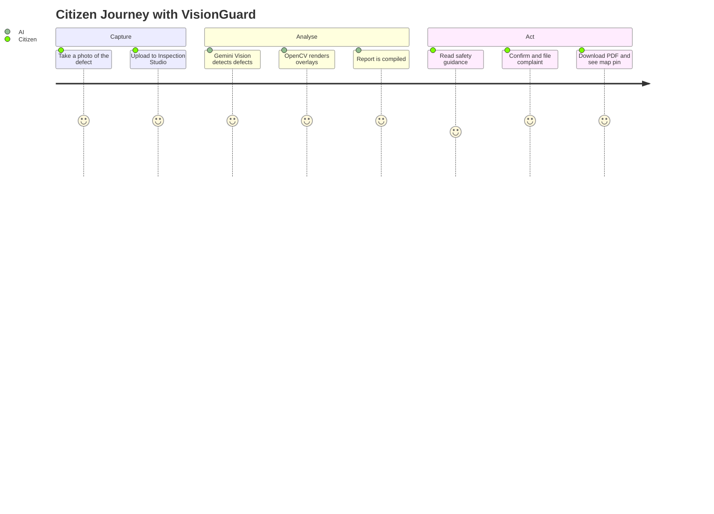
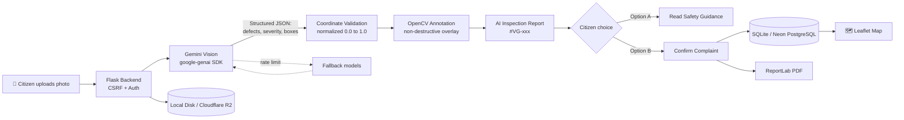

<div align="center">


### 🛡️ Gemini-Powered Multimodal Infrastructure Defect Detection Platform

<a href="https://github.com/szeeshanZ123/visionGuard">
  
</a>

<br/>


<br/>

[🚀 **Live Demo**]([ADD: LIVE DEMO URL]) &nbsp;•&nbsp; [🎥 **Demo Video**]([ADD: VIDEO URL]) &nbsp;•&nbsp; [📊 **Presentation**]([ADD: PPT URL]) &nbsp;•&nbsp; [🐞 **Report Issue**](https://github.com/szeeshanZ123/visionGuard/issues)

</div>

---

## ⏱️ The 60-Second Summary

| | |
|---|---|
| **🎯 Problem** | Road and building defects go unreported because inspection is slow and citizens have no easy way to file evidence-backed complaints. |
| **💡 Solution** | Upload one photo. Gemini Vision finds every visible defect, OpenCV marks it, and the citizen files a formal complaint PDF pinned on a live map. |
| **🧠 Core Tech** | Google Gemini Multimodal Vision · OpenCV · Flask · ReportLab · Leaflet.js |
| **✅ Proof** | 81 automated tests passing across AI inference, security and complaint workflows. |
| **🔒 Responsible AI** | Every result is labeled a *preliminary visual assessment*, never a certified survey. |

---

## 📑 Table of Contents

<details>
<summary><b>Click to expand</b></summary>

1. [The Problem](#-the-problem)
2. [Our Solution](#-our-solution)
3. [How It Works](#-how-it-works)
4. [Key Features](#-key-features)
5. [Why VisionGuard Stands Out](#-why-visionguard-stands-out)
6. [Screenshots & Demo](#-screenshots--demo)
7. [System Architecture](#-system-architecture)
8. [Tech Stack](#-tech-stack)
9. [Project Structure](#-project-structure)
10. [Getting Started](#-getting-started)
11. [Usage Walkthrough](#-usage-walkthrough)
12. [Testing & Quality](#-testing--quality)
13. [Results & Impact](#-results--impact)
14. [Limitations](#-limitations)
15. [Roadmap](#-roadmap)
16. [Contributors](#-contributors)
17. [Acknowledgements](#-acknowledgements)
18. [License & Disclaimer](#-license--disclaimer)

</details>

---

## 🚨 The Problem

Potholes, wall cracks, damp patches and spalling concrete are direct safety hazards for drivers, pedestrians and building occupants.

- 🐢 Manual inspections are **slow, subjective and hard to audit**.
- 📭 Citizens rarely have a way to **document evidence** and write a **formal municipal complaint**.
- 📉 Small defects are never reported, so they grow into expensive failures.

> 📌 [ADD: one real statistic about road or building damage in your region, with source]

---

## 💡 Our Solution

**VisionGuard AI** turns any smartphone photo into an **inspection report and an actionable civic complaint**.

> **Elevator pitch:** *Upload a photo, get an AI inspection report, and file a verified civic complaint in one flow.*

| Step | What happens |
|:---:|---|
| 1️⃣ | Citizen uploads a road or building photo |
| 2️⃣ | Gemini Vision identifies and itemizes defects (`[D001]`, `[D002]`) |
| 3️⃣ | OpenCV draws severity-coded boxes on a copy of the photo |
| 4️⃣ | An inspection report is generated (`#VG-xxx`) |
| 5️⃣ | Citizen reads safety guidance **or** files a complaint with PDF and map pin |

---

## 🔄 How It Works



---

## ✨ Key Features

<table>
<tr>
<td width="50%" valign="top">

### 🔍 Detection
- **Multi-defect itemization** with unique IDs
- **Road:** potholes, longitudinal, transverse and alligator cracks, raveling
- **Building:** wall cracks, dampness, peeling paint, plaster damage, spalling

</td>
<td width="50%" valign="top">

### 🎯 Visual Evidence
- **Non-destructive** OpenCV overlays; the original photo is never altered
- Normalized coordinate validation (`0.0 ≤ x1 < x2 ≤ 1.0`)
- Severity pills with defect IDs

</td>
</tr>
<tr>
<td width="50%" valign="top">

### 📝 Reports & Action
- Inspection reference ID (e.g. `#VG-104`)
- Remediation steps and urgency priority
- **Option A:** read guidance only
- **Option B:** verified complaint, PDF and map pin

</td>
<td width="50%" valign="top">

### 🔐 Reliability & Security
- CSRF validation and role-based access control
- API key never exposed to frontend, logs or responses
- **Automatic model fallback** on rate limits
- Duplicate complaint prevention

</td>
</tr>
</table>

### 🚦 Severity Color Code

| Severity | Color | Hex |
|---|---|---|
| Critical | 🔴 Crimson | `#EF4444` |
| High | 🟠 Orange | `#F97316` |
| Moderate | 🟡 Amber | `#F59E0B` |
| Low | 🔵 Blue | `#3B82F6` |
| Uncertain | ⚪ Slate | `#64748B` |

---

## 🏆 Why VisionGuard Stands Out

| Criteria | Manual Inspection | Typical Photo-Upload Apps | **VisionGuard AI 2.0** |
|---|:---:|:---:|:---:|
| Turnaround | Days to weeks | Minutes | ✅ **Minutes** |
| Multiple defects in one image | ❌ Manual notes | ⚠️ Often one label | ✅ **Itemized with IDs and boxes** |
| Annotated visual evidence | ❌ | ⚠️ Plain photo | ✅ **Non-destructive overlay** |
| Formal complaint document | ❌ Written by hand | ❌ Rare | ✅ **Auto-generated PDF** |
| Location tracking | ❌ | ⚠️ Limited | ✅ **Live Leaflet map** |
| Honest AI disclaimers | N/A | ⚠️ Often overclaims | ✅ **Built into every result** |
| Failure handling | N/A | ⚠️ Varies | ✅ **Model fallback, quota and timeout tests** |
| Running cost | High labor | Varies | ✅ **Free-tier-friendly model** |

> ✏️ [EDIT: replace the middle column with the real competitors you researched]

---

## 📸 Screenshots & Demo

<div align="center">


<br/><br/>

| 🏠 Landing Page | 🧪 Inspection Studio |
|:---:|:---:|
|  |  |
| **🎯 Annotated Overlay** | **📋 AI Inspection Report** |
|  |  |
| **✅ Complaint Confirmation** | **🗺️ Defect Map** |
|  |  |

</div>

---

## 🏗️ System Architecture



<details>
<summary><b>🧠 AI model management</b></summary>

- **Engine:** Google Gemini Multimodal Vision via the official `google-genai` SDK
- **Active model:** `gemini-3.1-flash-lite`, set with `GEMINI_MODEL`
- **Fallback rotation:** `gemini-flash-latest` → `gemini-3.8-flash` → `gemini-2.5-flash`
- **Research artifacts:** legacy YOLO weights (`ai/models/best.pt`, `home_best.pt`) are kept only for offline ablation studies and are **not** used in production

</details>

---

## 🧰 Tech Stack

| Layer | Technology |
|---|---|
| 🧠 **AI Vision** | Google Gemini Multimodal Vision · `google-genai` SDK |
| 🎨 **Annotation** | OpenCV (`opencv-python`) |
| ⚙️ **Backend** | Python 3.10+ · Flask 3.1 |
| 🖥️ **Server** | Waitress (Windows) · Gunicorn (Linux) |
| 🗄️ **Database** | SQLite · Neon PostgreSQL |
| ☁️ **Storage** | Local Disk · Cloudflare R2 |
| 📄 **PDF** | ReportLab 4.x |
| 🌐 **Frontend** | HTML5 · Tailwind CSS · Vanilla JS · Leaflet.js |
| 🧪 **Testing** | pytest |

<div align="center">


</div>

---

## 📁 Project Structure

```text
visionGuard/
├── ai/
│   ├── gemini_service.py      # Gemini vision, defect analysis, model fallback
│   └── models/                # Legacy YOLO weights (research only)
├── database/
│   └── db.py                  # SQLite / PostgreSQL persistence
├── data/
│   ├── visionguard.db         # Default local database
│   └── evaluation_benchmark/  # Benchmark images
├── tests/                     # 81 automated tests
├── assets/                    # README images and GIFs
├── wsgi.py                    # App entry point
├── requirements.txt
└── .env.example
```

> ✏️ [ADD: adjust any folder that differs from your real repo]

---

## 🚀 Getting Started

**Prerequisites:** Python 3.10 to 3.14 · `venv` · internet access · a free [Gemini API key](https://aistudio.google.com/)

```bash
# 1. Clone
git clone https://github.com/szeeshanZ123/visionGuard.git
cd visionGuard

# 2. Virtual environment
python -m venv venv
source venv/bin/activate        # Linux/macOS
.\venv\Scripts\activate         # Windows

# 3. Install dependencies
pip install -r requirements.txt

# 4. Configure environment
cp .env.example .env            # Windows: copy .env.example .env

# 5. Run
python wsgi.py
```

Open **http://127.0.0.1:5000** 🎉

<details>
<summary><b>🔑 Environment variables</b></summary>

```env
AI_PROVIDER=gemini
GEMINI_API_KEY=your_actual_gemini_api_key_here
GEMINI_MODEL=gemini-3.1-flash-lite
VISIONGUARD_SECRET_KEY=your_random_64_character_secret_key_here
VISIONGUARD_DB_PATH=data/visionguard.db
STORAGE_BACKEND=local
```

Generate a secret key:

```bash
python -c "import secrets; print(secrets.token_hex(32))"
```

Get an API key: open [Google AI Studio](https://aistudio.google.com/), sign in, click **Get API key**, and paste it into `.env`.

> 🔒 The key is read only from environment variables and never reaches frontend JavaScript, logs or API responses.

</details>

---

## 🎬 Usage Walkthrough

1. **Sign in** as a citizen (session security and CSRF protection are active).
2. **Open Inspection Studio** (`/create_home`) and choose *Road Surface Distress* or *Home & Building Defect*.
3. **Upload a photo**, e.g. `data/evaluation_benchmark/images/benchmark_08_d20_alligator_urban.jpg`.
4. **Click Detect Defect.** Watch five steps: Upload → Gemini analysis → Defect and severity identification → OpenCV overlay → Report compilation.
5. **Toggle** between the annotated overlay and the original photo.
6. **Review the report:** severity badge, summary, itemized defects, repair recommendations.
7. **Choose a pathway:**
   - **Option A:** read full guidance and safety steps.
   - **Option B:** check pre-filled GPS, address and notes, then confirm the complaint.
8. **Download the PDF** and find the new pin on the **Interactive Map**.

---

## ✅ Testing & Quality

```bash
python -m pytest tests/ -v
```

<div align="center">

**81 automated tests · 100% passing**

</div>

| Suite | Tests | What it proves |
|---|:---:|---|
| `test_gemini_multimodal_platform.py` | 17 | Road and building detection, multi-defect boxes, zero false positives on clean roads, blurry and invalid uploads, coordinate clamping, quota (HTTP 429) and timeout handling, missing-key diagnostics, non-destructive annotation, SQLite and PostgreSQL persistence, duplicate complaint prevention |
| `test_auth_and_roles.py` | RBAC | Role-based access enforcement |
| `test_citizen_csrf_security_routing.py` | Security | CSRF token validation |
| `test_complaint_assistance.py` | Workflow | Draft updates and PDF generation |
| `test_defect_map.py` | Geo | Geocoded marker queries |

> Regression and security suites together account for the remaining 64 tests.

---

## 📈 Results & Impact

| Metric | Value |
|---|---|
| Automated tests passing | **81 / 81** |
| Defect categories supported | **10** (5 road · 5 building) |
| Detection accuracy | [ADD: value and how it was measured] |
| Average analysis time per image | [ADD: seconds] |
| Benchmark images evaluated | [ADD: count] |
| People who tested the app | [ADD: count] |

> Only add numbers you actually measured. Judges trust real metrics.

---

## ⚠️ Limitations

- **Visual line-of-sight only.** Subsurface voids, internal rebar corrosion and underground leaks need specialized NDT equipment.
- **Image quality matters.** Dark or blurred photos may produce uncertain localization.
- **Preliminary screening only.** Results do not replace a certified engineering survey.

---

## 🗺️ Roadmap

- [x] Gemini multimodal defect detection
- [x] Multi-defect itemization with OpenCV overlays
- [x] Complaint workflow with PDF export
- [x] Interactive defect map
- [x] RBAC, CSRF protection and automated test suite
- [ ] Fine-tuned edge models (YOLOv8 Nano) for offline dashcam inference
- [ ] Drone survey ingestion (orthomosaic batches for roads and roofs)
- [ ] Municipal grievance integration through Open311 webhooks

---

## 👥 Contributors

<div align="center">

**Team [ADD: TEAM NAME]** · NEURA X 2026 — Global Hackathon 2K26

<table>
  <tr>
    <td align="center" width="220">
      <a href="https://github.com/szeeshanZ123">
        <br/>
        <b>Zeeshan</b>
      </a><br/>
      <sub>[ADD: ROLE]</sub><br/><br/>
      <a href="https://github.com/szeeshanZ123"></a>
    </td>
    <td align="center" width="220">
      <a href="https://github.com/Sandesh-Narkar">
        <br/>
        <b>Sandesh</b>
      </a><br/>
      <sub>[ADD: ROLE]</sub><br/><br/>
      <a href="https://github.com/Sandesh-Narkar"></a>
    </td>
    <td align="center" width="220">
      <a href="https://github.com/Yaswanth8407">
        <br/>
        <b>Yaswanth</b>
      </a><br/>
      <sub>[ADD: ROLE]</sub><br/><br/>
      <a href="https://github.com/Yaswanth8407"></a>
    </td>
    <td align="center" width="220">
      <a href="https://github.com/Sifatshaikh07">
        <br/>
        <b>Sifat Shaikh</b>
      </a><br/>
      <sub>[ADD: ROLE]</sub><br/><br/>
      <a href="https://github.com/Sifatshaikh07"></a>
    </td>
  </tr>
</table>

<a href="https://github.com/szeeshanZ123/visionGuard/graphs/contributors">
  
</a>

</div>

---

## 🙏 Acknowledgements

- **NEURA X 2026** organizers, mentors and judges
- [Google Gemini](https://ai.google.dev/) and Google AI Studio
- OpenCV · Flask · ReportLab · Leaflet.js · Tailwind CSS · Neon · Cloudflare R2

---

## 📜 License & Disclaimer

Licensed under **[ADD: LICENSE]**. See `LICENSE` for details.

> ⚖️ Preliminary visual defect assessments from VisionGuard AI 2.0 are for informational and civic assistance purposes only. They are not a certified structural engineering survey, legal warranty or municipal repair guarantee.

📬 **Contact:** [ADD: email] · [Repository](https://github.com/szeeshanZ123/visionGuard)

---

<div align="center">


**Built with ❤️ for NEURA X 2026 — Global Hackathon 2K26**

*If VisionGuard impressed you, please ⭐ the repo.*

[⬆ Back to top](#️-visionguard-ai-20)

</div>
